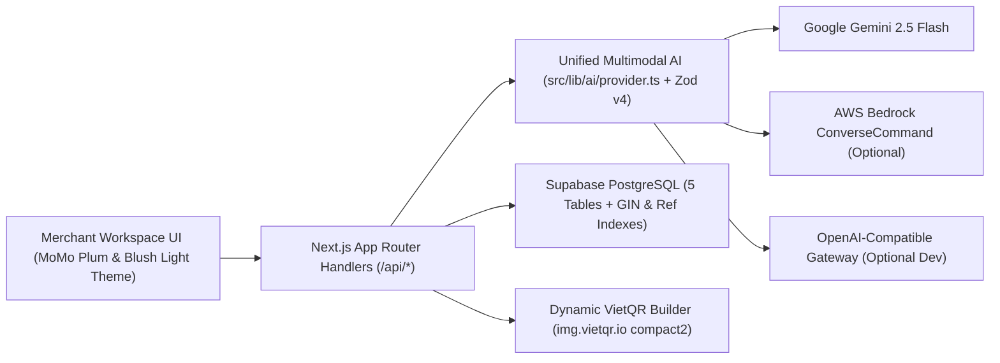

# Merchant AI Copilot

[](https://nextjs.org/)
[](https://www.typescriptlang.org/)
[](https://supabase.com/)
[](https://ai.google.dev/)
[](#)
[](#8-synthetic-data--privacy-compliance-note)

> **MoMo Tech Contest 2026** — *Imagine the Future Workspace: Human Centered. AI Powered*  
> **AI Counter Workspace** dành cho tiểu thương F&B và bán lẻ Việt Nam (**Tiệm Cà Phê Mộc**), kết hợp **Quầy thu ngân Hybrid POS + AI Quick Order & VietQR động**, **Hệ thống chống giả mạo biên lai chuyển khoản 4 lớp**, và **Trợ lý vận hành + Sổ nợ khách quen**.

---

## 1. Vấn đề thực tế & Giải pháp (Problem & Core Workflows)

Các quán cà phê, quán ăn nhỏ và tiệm bán lẻ tại Việt Nam xử lý đơn hàng liên tục qua lời gọi tại quầy, Zalo, Facebook Messenger và giấy ghi tay. Trong giờ cao điểm, chủ quán đối mặt 3 rủi ro lớn:
1. **Nhận đơn rời rạc, dễ tính nhầm:** Tin nhắn viết tắt tiếng lóng (*"2 bx ít ngọt, 1 cf sữa nhiều đá, tách 1 trà đào tính tiền mặt"*), giấy ghi tay, đọc miệng vội vàng dễ sót món, nhầm ghi chú hoặc tính sai tiền thối.
2. **Lừa đảo ảnh chụp màn hình chuyển khoản (Bill giả):** Kẻ gian chỉnh sửa số tiền trên ảnh (ví dụ sửa `6.400 ₫` thành `64.000 ₫`) hoặc gửi lại ảnh biên lai cũ trước khi nhân viên kịp kiểm tra biến động số dư.
3. **Thất thoát công nợ & đối soát cuối ngày:** Tiền mặt, chuyển khoản tách bill và sổ nợ khách quen (*ghi sổ*) theo dõi thủ công dễ gây sót doanh thu và khó mở lời nhắc nợ.

**Merchant AI Copilot** tổ chức quy trình tại quầy thành 3 màn hình nghiệp vụ + Bộ mô phỏng nhanh (`Alt+D`):

- **1. Quầy thu ngân (`OrderIntakePanel`) — Hybrid POS + AI Quick Order:**
  - Chọn nhanh món theo danh mục (`Tất cả`, `Cà phê`, `Trà trái cây`, `Trà sữa`, `Ăn vặt`, `Bánh ngọt`) hoặc nhập tin nhắn tiếng lóng, ảnh giấy ghi tay, giọng nói (Web Speech `vi-VN`) để AI bóc tách theo từ điển `menu_items.aliases`.
  - Hỗ trợ 4 hình thức thanh toán thực tế: **VietQR động** (`img.vietqr.io`), **Tiền mặt** (tích hợp máy tính tiền thừa với các nút mệnh giá `50k` / `100k` / `200k` / `500k` và nút *Đủ tiền*), **Tách tiền** (tiền mặt + VietQR phần còn lại), và **Ghi sổ** khách quen.
- **2. Kiểm duyệt CK (`ReceiptFraudInspector`) — Chống giả mạo biên lai 4 lớp (Human-in-the-Loop):**
  - Trích xuất thông tin biên lai bằng AI Vision và chạy 4 lớp kiểm chứng tất định:
    1. **Khớp số tiền tuyệt đối** (đối chiếu `extractedAmountVnd` với số tiền cần thu của đơn).
    2. **Chống dùng lại mã giao dịch** (tra cứu trùng `transaction_ref` trong PostgreSQL).
    3. **Mốc thời gian & nội dung CK** (kiểm tra biên lai quá cũ hoặc sai lệch nội dung).
    4. **Kiểm tra cắt ghép / sửa font** (cờ bất thường thị giác từ Vision).
  - Chủ quán quyết định **1 chạm Duyệt / Từ chối** (`POST /api/receipts/[id]/approve`).
- **3. Doanh thu & Sổ nợ (`OperationsCopilotPanel`):**
  - Hỏi đáp ngôn ngữ tự nhiên trên dữ liệu sống của quán (doanh thu đã thu theo Tiền mặt / VietQR, món bán chạy & món bán chậm, danh sách ghi sổ).
  - Soạn tin nhắn nhắc nợ lịch sự qua Zalo kèm sẵn mã **VietQR động** đúng số tiền và tất toán trực tiếp (`POST /api/debts/[id]/settle`).
- **4. Bộ mô phỏng nhanh (`Alt+D`) & Khôi phục dữ liệu (`POST /api/demo/reset`):**
  - Drawer trượt bên phải (mặc định ẩn, mở bằng nút *Bộ mô phỏng nhanh* hoặc phím tắt `Alt+D`) cung cấp sẵn 6 kịch bản kiểm thử trực tiếp: tin nhắn tiếng lóng Bàn 3, giấy ghi tay Bàn 2, bill hợp lệ, bill sửa `6.400 ₫ → 64.000 ₫`, bill trùng mã `FT26330998811`, và tổng kết ca + nhắc nợ.

---

## 2. Kiến trúc hệ thống (System Architecture)



---

## 3. Tiến độ & Danh sách API (Roadmap & API Status)

| Thành phần | Trạng thái | Mô tả |
| :--- | :---: | :--- |
| **Foundation & DB Schema** (`supabase/schema.sql`, `src/lib/*`) | **Live & Verified** | 5 bảng PostgreSQL (`menu_items`, `orders`, `order_items`, `payment_receipts`, `customer_debts`), Zod v4 schemas, VietQR builder, Unified AI provider |
| `GET /api/health` | **Live & Verified** | Kiểm tra trạng thái AI provider & kết nối Supabase (`await connection()`, không lộ secret) |
| `GET /api/store/state` | **Live & Verified** | Truy vấn snapshot thực đơn, đơn hàng, biên lai, công nợ và KPI ngày (`await connection()`) |
| `POST /api/demo/reset` | **Live & Verified** | Đưa dữ liệu mẫu về trạng thái chuẩn (`DH1001`–`DH1003`, `FT26330998811`) |
| `POST /api/orders` | **Live & Verified** | Tạo và lưu đơn hàng POS thủ công hoặc đơn nháp đã chỉnh sửa (VietQR / Tiền mặt / Tách tiền / Ghi sổ) |
| `POST /api/orders/parse` | **Live & Verified** | Bóc tách đơn đa phương thức (chat/handwritten image/voice) + chuẩn hóa giá & VietQR động |
| `POST /api/receipts/verify` | **Live & Verified** | Trích xuất biên lai bằng AI Vision và chạy bộ kiểm chứng chống giả mạo 4 lớp |
| `POST /api/receipts/[id]/approve` | **Live & Verified** | Duyệt hoặc từ chối biên lai theo cơ chế Human-in-the-Loop, đồng bộ trạng thái đơn hàng |
| `POST /api/debts/[id]/settle` | **Live & Verified** | Tất toán khoản ghi sổ khách quen và cập nhật trạng thái đơn sang `paid` |
| `POST /api/copilot` | **Live & Verified** | Trợ lý vận hành tổng hợp doanh thu, món bán chậm & soạn tin nhắn nhắc nợ kèm VietQR |
| `public/demo-assets/*.png` | **Live & Verified** | 4 ảnh giả lập (`handwritten-order-demo.png`, `receipt-valid-new.png`, `receipt-tampered-6400.png`, `receipt-dh1001-valid.png`) |
| **Workspace UI (Phases 3–4)** | **Live & Verified** | Giao diện sáng MoMo Plum & Blush (`#A50064` / `#FBF8FA`), 3 tab (*Quầy thu ngân*, *Kiểm duyệt CK*, *Doanh thu & Sổ nợ*), mobile dock, Simulator Drawer `Alt+D` |

---

## 4. Tech Stack

- **Framework & Runtime:** Next.js `16.4.6` (App Router, Turbopack, `cacheComponents: true`), React `19.3.0`, TypeScript `5` (`strict: true`)
- **UI System:** Tailwind CSS `v4` (`@tailwindcss/turbopack`), Shadcn UI (`@base-ui/react`, `class-variance-authority`, `tw-animate-css`, `next-themes`), Lucide React, Sonner, Google Fonts (`Be Vietnam Pro`, `JetBrains Mono`) — Light Fintech palette (MoMo Plum `#A50064` & Blush `#FBF8FA`)
- **Database:** Supabase PostgreSQL (`@supabase/supabase-js`) với GIN index cho `menu_items.aliases` và B-tree index cho `payment_receipts.transaction_ref`
- **Multimodal AI Layer (`src/lib/ai/provider.ts`):**
  - **Google Gemini (`@google/genai`):** `gemini-2.5-flash` (structured JSON + Vision)
  - **AWS Bedrock (`@aws-sdk/client-bedrock-runtime`):** `ConverseCommand` pay-per-use (`apac.amazon.nova-lite-v1:0`)
  - **OpenAI-Compatible Gateway (`agnes`):** Hỗ trợ endpoint tương thích `/v1/chat/completions` (`agnes-2.5-flash`) cho môi trường dev/test
- **Validation & Payment Standard:** Zod v4 (`src/lib/ai/schemas.ts`), Dynamic VietQR (`img.vietqr.io`)

---

## 5. Hướng dẫn Cài đặt Local & Deploy Vercel

### Yêu cầu trước khi chạy
- Node.js `>= 20.x` và `pnpm` (`>= 10.x`, cấu hình repo dùng `pnpm@12.4.2`)
- 1 project Supabase (Free tier)
- `GEMINI_API_KEY` (hoặc thông tin AWS Bedrock pay-per-use / Agnes gateway)

### Chạy Local
1. **Cài đặt thư viện:**
   ```bash
   pnpm install
   ```
2. **Tạo file môi trường:**
   ```bash
   cp .env.example .env.local
   ```
   Điền các khóa thật vào `.env.local` (file này đã được `.gitignore` chặn tuyệt đối khỏi Git).
3. **Khởi tạo Database & Dữ liệu mẫu:**
   Mở **Supabase Dashboard → SQL Editor**, dán toàn bộ nội dung [`supabase/schema.sql`](./supabase/schema.sql) (bao gồm các lệnh `GRANT` cho `service_role`) và bấm **Run**.
4. **Chạy server phát triển & kiểm tra Build:**
   ```bash
   pnpm dev
   # Truy cập http://localhost:3000/api/health
   pnpm exec tsc --noEmit && pnpm lint && pnpm build
   ```

### Deploy lên Vercel
1. Đảm bảo repository GitHub ở chế độ **Private** trong suốt thời gian cuộc thi (tuân thủ Điều 28.6 & 31.3 Thể lệ MoMo Tech Contest 2026) và tuân thủ mốc đóng băng mã nguồn sau thời hạn nộp bài 03/12/2026 (Điều 10.4–10.5).
2. Trên Vercel chọn **Add New Project → Import `merchant-ai-copilot`** (Framework: `Next.js`, Root Directory: `./`).
3. Thêm đầy đủ các biến môi trường trong bảng mục 6 vào **Project Settings → Environment Variables** rồi bấm **Deploy**.

---

## 6. Environment Variables Reference

| Biến môi trường | Phạm vi | Bắt buộc | Mô tả |
| :--- | :---: | :---: | :--- |
| `NEXT_PUBLIC_SUPABASE_URL` | Public | Có | URL project Supabase (`https://<project-ref>.supabase.co`, không kèm `/rest/v1/`) |
| `NEXT_PUBLIC_SUPABASE_ANON_KEY` | Public | Có | Supabase public/publishable key |
| `SUPABASE_SERVICE_ROLE_KEY` | **Server-Only** | Có | Service role / secret key dùng riêng trong `src/lib/supabase/server.ts` |
| `AI_PROVIDER` | Server-Only | Có | Nhà cung cấp AI đang kích hoạt: `gemini`, `bedrock` hoặc `agnes` |
| `GEMINI_API_KEY` | **Server-Only** | Khi dùng `gemini` | Gemini API key cho `@google/genai` |
| `GEMINI_MODEL_ID` | Server-Only | Tùy chọn | Mặc định `gemini-2.5-flash` |
| `AWS_REGION` | Server-Only | Khi dùng `bedrock` | Vùng AWS (mặc định `ap-southeast-1`) |
| `AWS_ACCESS_KEY_ID` | **Server-Only** | Khi dùng `bedrock` | IAM Access Key ID |
| `AWS_SECRET_ACCESS_KEY` | **Server-Only** | Khi dùng `bedrock` | IAM Secret Access Key |
| `BEDROCK_MODEL_ID` | Server-Only | Tùy chọn | Mặc định `apac.amazon.nova-lite-v1:0` |
| `AWS_S3_BUCKET` | Server-Only | Tùy chọn | S3 bucket riêng tư cho ảnh biên lai tạm |
| `AGNES_API_KEY` / `AGNES_BASE_URL` / `AGNES_MODEL_ID` | **Server-Only** | Khi dùng `agnes` | Gateway tương thích OpenAI cho thử nghiệm (`agnes-2.5-flash`) |
| `NEXT_PUBLIC_VIETQR_BANK_ID` | Public | Tùy chọn | Mã ngân hàng giả lập (mặc định `MB`) |
| `NEXT_PUBLIC_VIETQR_ACCOUNT_NO` | Public | Tùy chọn | Số tài khoản giả lập (mặc định `0123456789`) |
| `NEXT_PUBLIC_VIETQR_ACCOUNT_NAME` | Public | Tùy chọn | Tên chủ tài khoản giả lập (mặc định `TIEM CA PHE MOC`) |

---

## 7. Pre-existing Assets & AI Tools Declaration
*(Khai báo theo Điều 10.4–10.5, Điều 12.5, Điều 28.1, Điều 28.3, Điều 28.4 và Điều 28.6 Thể lệ MoMo Tech Contest 2026)*

- **Mã nguồn & Quyền sở hữu:** Toàn bộ logic nghiệp vụ, schema database, bộ lọc chống giả mạo 4 lớp, bộ ảnh demo và giao diện đều được xây dựng mới trong thời gian diễn ra cuộc thi; không tái sử dụng sản phẩm thương mại có sẵn. Repository được cấu hình giữ ở chế độ **Private** và đóng băng chỉnh sửa sau hạn nộp bài (03/12/2026).
- **Thư viện mã nguồn mở & Assets bên thứ ba:**
  - Framework & Tooling: `next`, `react`, `react-dom`, `eslint`, `eslint-config-next`, `tailwindcss`, `@tailwindcss/turbopack` (`MIT`); `typescript` (`Apache-2.0`).
  - UI & Validation: `@base-ui/react`, `class-variance-authority`, `next-themes`, `shadcn`, `sonner`, `tw-animate-css`, `zod` (`MIT`); `lucide-react` (`ISC`).
  - Backend & AI SDKs: `@supabase/supabase-js` (`MIT`); `@google/genai`, `@aws-sdk/client-bedrock-runtime`, `@aws-sdk/client-s3` (`Apache-2.0`).
  - Fonts & Payment QR: Google Fonts `Be Vietnam Pro` & `JetBrains Mono` (`SIL Open Font License 1.1`); Dynamic VietQR public image endpoint (`https://img.vietqr.io`).
- **Công cụ & Mô hình AI sử dụng:**
  - *Trong sản phẩm (Runtime):* Google Gemini (`gemini-2.5-flash`), adapter dự phòng Amazon Bedrock (`ConverseCommand` / `apac.amazon.nova-lite-v1:0`), và adapter dev/test tương thích OpenAI (`agnes-2.5-flash`).
  - *Trong quá trình phát triển:* Nhóm sử dụng công cụ hỗ trợ lập trình AI (Antigravity / Kiro steering specs); toàn bộ mã nguồn, ràng buộc bảo mật và kết quả kiểm thử đều được rà soát và xác thực trực tiếp.

---

## 8. Synthetic Data & Privacy Compliance Note
*(Tuân thủ Điều 10.5, Điều 12.4, Điều 29 & Điều 31.4 Thể lệ MoMo Tech Contest 2026)*

- **100% Dữ liệu Giả lập (Zero Real PII):** Toàn bộ thực đơn, đơn hàng (`DH1001`–`DH1003`), mã giao dịch (`FT26330998811`, `FT26330998901`, `FT26330998899`), tài khoản demo (`MB - 0123456789 - TIEM CA PHE MOC`), thông tin khách hàng mẫu (`Chị Lan tiệm hoa`, `Anh Minh văn phòng`, `@lan.tiemhoa.demo`, `0900-000-102`), ảnh biên lai trong `public/demo-assets/` đều là dữ liệu tổng hợp phục vụ demo.
- **Bảo mật & Cách ly khóa bí mật:** Không thu thập hay lưu trữ dữ liệu cá nhân thật, số điện thoại/CCCD thật hay biên lai giao dịch thật; toàn bộ biến bí mật chỉ nạp qua `.env.local` (đã bị `.gitignore` loại trừ) và Vercel Environment Variables, kèm kiểm tra `typeof window !== 'undefined'` trên Supabase admin client.
