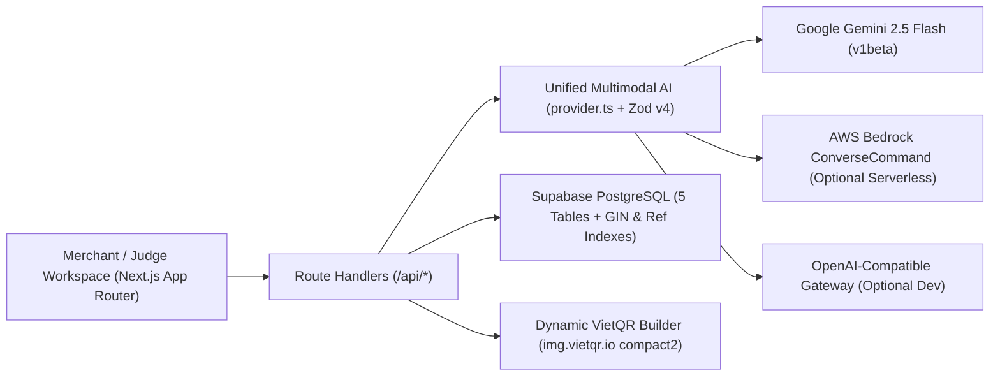

# Merchant AI Copilot

[](https://nextjs.org/)
[](https://www.typescriptlang.org/)
[](https://supabase.com/)
[](https://ai.google.dev/)
[](#)
[](#8-synthetic-data--privacy-compliance-note)

> **MoMo Tech Contest 2026** — *Imagine the Future Workspace: Human Centered. AI Powered*  
> **AI Counter Workspace** dành cho tiểu thương F&B và bán lẻ Việt Nam, kết hợp **Trợ lý nhận đơn đa phương thức + VietQR động** và **Hệ thống chống giả mạo biên lai chuyển khoản 4 lớp**.

---

## 1. Vấn đề thực tế & Giải pháp (Problem & Core Workflows)

Các quán cà phê, quán ăn nhỏ và tiệm bán lẻ tại Việt Nam xử lý hàng trăm đơn mỗi ngày qua lời gọi tại quầy, Zalo và Facebook Messenger. Trong giờ cao điểm, chủ quán đối mặt 3 rủi ro lớn:
1. **Nhận đơn rời rạc, dễ tính nhầm:** Tin nhắn viết tắt tiếng lóng (*"2 bx ít ngọt, 1 cf sữa, tách 1 trà đào tính tiền mặt"*), giấy ghi tay, đọc miệng vội vàng rất dễ sót topping/modifier hoặc sai tiền thối.
2. **Lừa đảo ảnh chụp màn hình chuyển khoản (Bill giả):** Kẻ gian chỉnh sửa số tiền trên ảnh (ví dụ sửa `6.400 ₫` thành `64.000 ₫`) hoặc gửi lại ảnh biên lai cũ trước khi nhân viên kịp kiểm tra biến động số dư.
3. **Thất thoát công nợ & đối soát cuối ngày:** Tiền mặt, chuyển khoản tách bill và sổ nợ khách quen (*ghi sổ*) theo dõi thủ công gây sót doanh thu và ngại mở lời nhắc nợ.

**Merchant AI Copilot** giải quyết trọn vẹn bằng 4 luồng nghiệp vụ lấy con người làm trung tâm:
- **1. Multimodal Order Intake + Dynamic VietQR:** Bóc tách tin nhắn tiếng lóng Zalo/FB, ảnh giấy ghi tay hoặc giọng nói thành đơn hàng chuẩn hóa theo từ điển `aliases`, tự tính tiền mặt/chuyển khoản/giảm giá khách quen và sinh mã **VietQR động** (`img.vietqr.io`) đúng số tiền & mã đơn.
- **2. 4-Layer Payment Receipt Anti-Fraud (Human-in-the-Loop):** Trích xuất thông tin biên lai bằng AI Vision và chạy 4 lớp kiểm chứng tất định (**khớp số tiền tuyệt đối**, **truy vết trùng `transaction_ref` trong DB**, **bất thường thời gian**, **dấu hiệu chỉnh sửa ảnh**) để chủ quán bấm **1 chạm Duyệt / Từ chối**.
- **3. Natural-Language Operations Copilot:** Hỏi đáp ngôn ngữ tự nhiên trên dữ liệu sống của quán để tổng kết doanh thu, cảnh báo món bán chậm và soạn tin nhắn nhắc nợ lịch sự kèm sẵn link VietQR.
- **4. Judge Quick-Demo Mode (< 60s, Zero Login):** Tích hợp sẵn kịch bản tiếng lóng, 3 mẫu test bill (Hợp lệ / Sửa 6.4k→64k / Dùng lại `FT26330998811`) và nút `POST /api/demo/reset` giúp Ban Giám khảo trải nghiệm toàn bộ sản phẩm dưới 60 giây.

---

## 2. Kiến trúc hệ thống (System Architecture)



---

## 3. Tiến độ & Danh sách API (Roadmap & API Status)

| Thành phần | Trạng thái | Mô tả |
| :--- | :---: | :--- |
| **Foundation & DB Schema** (`supabase/schema.sql`, `src/lib/*`) | **Live & Verified** | 5 bảng PostgreSQL (`menu_items`, `orders`, `order_items`, `payment_receipts`, `customer_debts`), Zod v4 schemas, VietQR builder, Unified AI provider |
| `GET /api/health` | **Live & Verified** | Kiểm tra trạng thái AI provider & kết nối Supabase (không lộ secret) |
| `GET /api/store/state` | **Live & Verified** | Truy vấn snapshot thực đơn, đơn hàng, biên lai, công nợ và KPI ngày |
| `POST /api/demo/reset` | **Live & Verified** | Đưa dữ liệu mẫu về trạng thái chuẩn (`DH1001`–`DH1003`, `FT26330998811`) |
| `public/demo-assets/*.png` | **Live & Verified** | 4 ảnh giả lập (giấy ghi tay Bàn 2, bill hợp lệ, bill sửa `6.4k→64k`, bill replay `FT26330998811`) |
| `POST /api/orders/parse` | **Planned (Phase 2)** | Bóc tách đơn đa phương thức (text/voice/handwritten) + tạo đơn + VietQR động |
| `POST & PATCH /api/receipts/verify` | **Planned (Phase 2)** | Chẩn đoán chống bill giả 4 lớp + duyệt/từ chối Human-in-the-Loop |
| `POST /api/copilot` | **Planned (Phase 2)** | Trợ lý vận hành tổng hợp doanh thu, món bán chậm & soạn tin nhắc nợ |
| **3-Panel AI Workspace UI** | **Planned (Phases 3–4)** | Giao diện Tím MoMo hồng phấn, micro Web Speech tiếng Việt & Quick-Demo Bar |

---

## 4. Tech Stack

- **Framework & Runtime:** Next.js 16.4 (App Router, Turbopack), React 19, TypeScript 5 (`strict: true`)
- **UI System:** Tailwind CSS v4, Shadcn UI (Base UI / Neutral + điểm nhấn Tím MoMo hồng phấn), Lucide React, Sonner
- **Database:** Supabase PostgreSQL (`@supabase/supabase-js`) với GIN index cho `menu_items.aliases` và B-tree index cho `payment_receipts.transaction_ref`
- **Multimodal AI Layer (`src/lib/ai/provider.ts`):**
  - **Google Gemini (`@google/genai`):** `gemini-2.5-flash` (`v1beta` structured JSON + Vision)
  - **AWS Bedrock (`@aws-sdk/client-bedrock-runtime`):** `ConverseCommand` pay-per-use (`apac.amazon.nova-lite-v1:0`)
  - **OpenAI-Compatible Adapter:** Hỗ trợ endpoint tương thích `/v1/chat/completions` cho môi trường dev
- **Validation & Payment Standard:** Zod v4 (`src/lib/ai/schemas.ts`), Dynamic VietQR (`img.vietqr.io`)

---

## 5. Hướng dẫn Cài đặt Local & Deploy Vercel

### Yêu cầu trước khi chạy
- Node.js `>= 20.x` và `pnpm` (`>= 10.x`)
- 1 project Supabase (Free tier)
- `GEMINI_API_KEY` (hoặc thông tin AWS Bedrock pay-per-use)

### Chạy Local
1. **Cài đặt thư viện:**
   ```bash
   pnpm install
   ```
2. **Tạo file môi trường:**
   ```bash
   cp .env.example .env.local
   ```
   Điền các khóa thật vào `.env.local` (file này đã được `.gitignore` chặn tuyệt đối khỏi Git).
3. **Khởi tạo Database & Dữ liệu mẫu:**
   Mở **Supabase Dashboard → SQL Editor**, dán toàn bộ nội dung [`supabase/schema.sql`](./supabase/schema.sql) (bao gồm các lệnh `GRANT` cho `service_role`) và bấm **Run**.
4. **Chạy server phát triển & kiểm tra Build:**
   ```bash
   pnpm dev
   # Truy cập http://localhost:3000/api/health
   pnpm exec tsc --noEmit && pnpm build
   ```

### Deploy lên Vercel (Khuyên dùng)
1. Giữ repository GitHub ở chế độ **Private** trong suốt thời gian cuộc thi.
2. Trên Vercel chọn **Add New Project → Import `merchant-ai-copilot`** (Framework: `Next.js`, Root Directory: `./`).
3. Thêm đầy đủ các biến môi trường trong bảng mục 6 vào **Project Settings → Environment Variables** rồi bấm **Deploy**.

---

## 6. Environment Variables Reference

| Biến môi trường | Phạm vi | Bắt buộc | Mô tả |
| :--- | :---: | :---: | :--- |
| `NEXT_PUBLIC_SUPABASE_URL` | Public | Có | URL project Supabase (`https://<project-ref>.supabase.co`, không kèm `/rest/v1/`) |
| `NEXT_PUBLIC_SUPABASE_ANON_KEY` | Public | Có | Supabase public/publishable key |
| `SUPABASE_SERVICE_ROLE_KEY` | **Server-Only** | Có | Service role / secret key dùng riêng trong `src/lib/supabase/server.ts` |
| `AI_PROVIDER` | Server-Only | Có | Nhà cung cấp AI đang kích hoạt: `gemini`, `bedrock` hoặc `agnes` |
| `GEMINI_API_KEY` | **Server-Only** | Khi dùng `gemini` | Gemini API key cho `@google/genai` |
| `GEMINI_MODEL_ID` | Server-Only | Tùy chọn | Mặc định `gemini-2.5-flash` |
| `AWS_REGION` | Server-Only | Khi dùng `bedrock` | Vùng AWS (mặc định `ap-southeast-1`) |
| `AWS_ACCESS_KEY_ID` | **Server-Only** | Khi dùng `bedrock` | IAM Access Key ID |
| `AWS_SECRET_ACCESS_KEY` | **Server-Only** | Khi dùng `bedrock` | IAM Secret Access Key |
| `BEDROCK_MODEL_ID` | Server-Only | Tùy chọn | Mặc định `apac.amazon.nova-lite-v1:0` |
| `AWS_S3_BUCKET` | Server-Only | Tùy chọn | S3 bucket riêng tư cho ảnh biên lai tạm |
| `AGNES_API_KEY` / `AGNES_BASE_URL` / `AGNES_MODEL_ID` | **Server-Only** | Khi dùng `agnes` | Gateway tương thích OpenAI cho thử nghiệm |
| `NEXT_PUBLIC_VIETQR_BANK_ID` | Public | Tùy chọn | Mã ngân hàng giả lập (mặc định `MB`) |
| `NEXT_PUBLIC_VIETQR_ACCOUNT_NO` | Public | Tùy chọn | Số tài khoản giả lập (mặc định `0123456789`) |
| `NEXT_PUBLIC_VIETQR_ACCOUNT_NAME` | Public | Tùy chọn | Tên chủ tài khoản giả lập (mặc định `QUAN CA PHE DEMO`) |

---

## 7. Pre-existing Assets & AI Tools Declaration
*(Khai báo theo Điều 12.5, Điều 28.1, Điều 28.3 và Điều 28.4 Thể lệ MoMo Tech Contest 2026)*

- **Mã nguồn & Kiến trúc:** Toàn bộ logic nghiệp vụ, schema database, bộ lọc chống giả mạo 4 lớp, bộ ảnh demo và giao diện đều được xây dựng mới trong thời gian diễn ra cuộc thi; không tái sử dụng sản phẩm thương mại có sẵn.
- **Thư viện mã nguồn mở:** Next.js & React (MIT), Tailwind CSS & Shadcn UI / Base UI / Lucide / Sonner (MIT / ISC), `@supabase/supabase-js` (MIT), `@google/genai` (Apache-2.0), `@aws-sdk/client-bedrock-runtime` & `@aws-sdk/client-s3` (Apache-2.0), `zod` (MIT), Dynamic VietQR public image endpoint (`https://img.vietqr.io`).
- **Công cụ & Mô hình AI sử dụng:**
  - *Trong sản phẩm (Runtime):* Google Gemini (`gemini-2.5-flash`) và adapter dự phòng Amazon Bedrock (`ConverseCommand` / `apac.amazon.nova-lite-v1:0`).
  - *Trong quá trình phát triển:* Nhóm sử dụng công cụ hỗ trợ lập trình AI (Antigravity / Kiro steering specs); toàn bộ mã nguồn, ràng buộc bảo mật và kết quả kiểm thử đều được rà soát và xác thực trực tiếp.

---

## 8. Synthetic Data & Privacy Compliance Note
*(Tuân thủ Điều 10.5, Điều 12.4, Điều 29 & Điều 31.4 Thể lệ MoMo Tech Contest 2026)*

- **100% Dữ liệu Giả lập (Zero Real PII):** Toàn bộ thực đơn, đơn hàng (`DH1001`–`DH1003`), mã giao dịch (`FT26330998811`, `FT26330998901`, `FT26330998899`), tài khoản demo (`MB - 0123456789 - QUAN CA PHE DEMO`), ảnh biên lai trong `public/demo-assets/` và khách hàng mẫu đều là dữ liệu tổng hợp phục vụ demo.
- **Bảo mật & Đóng băng sản phẩm:** Không thu thập hay lưu trữ dữ liệu cá nhân thật, số điện thoại/CCCD thật hay biên lai giao dịch thật; toàn bộ biến bí mật chỉ nạp qua `.env.local` và Vercel Environment Variables.
